

 



 

<table align="center">
<tr>
<td width="33%" valign="top">

**🛠 Engineering** 
Full-stack web, cross-platform mobile, REST APIs, database design and system architecture.

</td>
<td width="33%" valign="top">

**🎨 Design** 
UI/UX research, Figma prototyping, design systems and motion that serves the product.

</td>
<td width="33%" valign="top">

**🧠 Data & AI** 
Python analysis, visualisation and AI features integrated into real products.

</td>
</tr>
</table>

 

## ⚡ Tech Stack



 

| Layer | Tools |
|:--|:--|
| **Mobile** |  |
| **Frontend** |  |
| **Backend** |  |
| **Databases** |  |
| **Design & Tools** |  |

 

## 🚀 Featured Work


<table>
<tr>
<td></td>
<td></td>
</tr>
<tr>
<td></td>
<td></td>
</tr>
</table>

Most client work stays private during active development. Walkthroughs and case studies on request.

 

## 🧭 How I Work


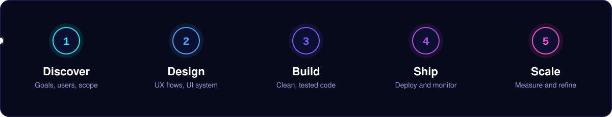

 

<b>⚙️ Engineering principles</b>

 

- **Design-system first.** Tokens and components before screens, so products stay consistent as they grow.
- **Hand-crafted code.** Every line is understood and owned. No generated scaffolding I can't maintain.
- **Ship small, measure, refine.** Working increments beat long plans.
- **Security and data modelling up front.** Auth, roles and schema are decided early, not patched later.

<b>📦 What I can deliver</b>

 

- SaaS platforms and business management systems
- Marketplaces and e-commerce
- Cross-platform mobile apps (Flutter + Supabase / Firebase / Laravel API)
- Admin dashboards, analytics and reporting
- Brand-aligned UI/UX and design systems
- AI-powered features and data pipelines

<b>📈 Currently levelling up</b>

 

- Cloud and DevOps (CI/CD, containers, deployment pipelines)
- Advanced system design
- Applied machine learning

 

## 📊 GitHub Analytics


 

## 🌐 Let's Build


 

**Have a product idea, a system to modernise, or an app to ship?**

  


