<div align="center">



<br/>

<a href="https://readme-typing-svg.demolab.com">
  
</a>

<br/><br/>


<br/>


<br/><br/>

<a href="mailto:apinaashs@gmail.com"></a>
<a href="https://instagram.com/the_ashiin3_"></a>
<a href="https://github.com/shiine89"></a>


</div>

## 🧬 About

```ts
const shiine = {
  name:     "Eng. Shiine",
  company:  "Mareeg Softwares",
  location: "Somalia",
  roles:    ["Full-Stack Engineer", "Mobile Developer", "UI/UX Designer", "Data Science Engineer"],
  building: ["SaaS platforms", "Marketplaces", "Business management systems", "AI-powered tools"],
  approach: "Hand-crafted code. Design-system first. Ship, measure, refine.",
  mission:  "Build products that solve real problems and create measurable value.",
} as const;
```

<div align="center"></div>

## ⚡ Tech Stack

<div align="center">

| Layer | Tools |
|:--|:--|
| **Mobile** |  |
| **Frontend** |  |
| **Backend** |  |
| **Databases** |  |
| **Design & Tools** |  |

</div>

<div align="center"></div>

## 🚀 Featured Work

<div align="center">

| | Project | Stack | Focus |
|:--:|:--|:--|:--|
| 🏠 | **HoyiHel** | Flutter · Supabase | Somali real estate marketplace |
| ✂️ | **BarberPro** | Flutter · Supabase | Barbershop / salon management |
| 💄 | **FH-Glow** | Laravel · Flutter | Backend + mobile app |
| 🌐 | **Mareeg Softwares** | Next.js · React | Agency site & portfolio |

</div>

> Most client work stays private. Walkthroughs and case studies available on request.

<div align="center"></div>

## 📊 GitHub Analytics

<div align="center">


</div>

<div align="center"></div>

## 🧠 Expertise

<details open>
<summary><b>Engineering</b></summary>

- Full-stack web (React, Next.js, Laravel, Node/Express)
- Cross-platform mobile (Flutter + Supabase / Firebase)
- REST API design, database modelling, authentication & roles
- Software architecture and system design
</details>

<details>
<summary><b>Design</b></summary>

- UI/UX research, wireframing, prototyping in Figma
- Design systems, tokens and component libraries
- Motion and interaction design
</details>

<details>
<summary><b>Data & AI</b></summary>

- Data analysis and visualisation in Python
- Integrating AI features into products
</details>

<details>
<summary><b>Currently levelling up</b></summary>

- Cloud & DevOps (CI/CD, containers, deployment)
- Advanced system design
- Applied machine learning
</details>

<div align="center"></div>

## 🐍 Contribution Snake

<div align="center">

</div>

## 🌐 Let's Build Something

<div align="center">

**Have a product idea, a system to modernise, or an app to ship?**

<a href="mailto:apinaashs@gmail.com"></a>

<br/>

*Great products emerge when engineering, design, and business thinking work together.*

<br/>


</div>


